# INFORME DEL TALLER PRÁCTICO: EXPLORACIÓN DE HDFS Y HADOOP MAPREDUCE CON DOCKER

**Fecha:** 9 de noviembre de 2026  
**Tema:** HDFS, Hadoop, YARN, MapReduce y Docker

---

## 1. Introducción

En este taller práctico trabajé con herramientas del ecosistema Big Data para conocer cómo se almacenan y procesan datos en un sistema distribuido. Para desarrollar la actividad utilicé Docker Desktop y Docker Compose, que permitieron desplegar un clúster local de Hadoop sin necesidad de instalar todos los servicios directamente en Windows.

El entorno estuvo compuesto por un NameNode, dos DataNodes, un ResourceManager, un NodeManager y un HistoryServer.

Posteriormente, se cargaron archivos de prueba en HDFS y se ejecutaron tres trabajos MapReduce: conteo de palabras, cálculo del precio promedio por categoría y selección de los tres productos con mayores ingresos.

También se verificó la ejecución mediante YARN, se consultaron los logs de las aplicaciones y se realizó una prueba controlada de tolerancia a fallos mediante la detención temporal de un DataNode.

## 2. Objetivos

### 2.1. Objetivo general

Explorar el funcionamiento del almacenamiento distribuido en HDFS y el procesamiento de datos mediante Hadoop MapReduce, a través del despliegue de un clúster local con Docker y la realización de pruebas de ejecución, monitoreo y tolerancia a fallos.

### 2.2. Objetivos específicos

- Desplegar un clúster Hadoop con un NameNode y dos DataNodes.
- Verificar el funcionamiento de HDFS y YARN mediante sus interfaces web y comandos.
- Cargar archivos de prueba en HDFS.
- Ejecutar tres trabajos MapReduce utilizando Hadoop Streaming.
- Validar manualmente los resultados obtenidos.
- Revisar los estados y logs de las aplicaciones.
- Evaluar el comportamiento de HDFS al detener y recuperar un DataNode.

---

## 3. Arquitectura y despliegue del clúster

Para comenzar el taller se utilizó Docker Desktop junto con Docker Compose.

El archivo `docker-compose.yml` permitió configurar los diferentes servicios de Hadoop dentro de contenedores que se comunican mediante una red local.

### 3.1. Componentes del clúster

| Componente | Función |
|---|---|
| NameNode | Administra los metadatos de HDFS y la ubicación de los bloques. |
| DataNode 1 | Almacena bloques de información. |
| DataNode 2 | Almacena bloques y permite mantener réplicas. |
| ResourceManager | Administra los recursos del clúster YARN. |
| NodeManager | Gestiona la ejecución de tareas y contenedores. |
| HistoryServer | Permite consultar información histórica de los trabajos MapReduce. |

### 3.2. Inicio del clúster

Para iniciar los contenedores se ejecutó:

```powershell
docker compose up -d
```

Posteriormente se verificó su funcionamiento:

```powershell
docker compose ps
```

Este procedimiento permitió comprobar que los servicios configurados se encontraban en ejecución.

**Evidencia 1. Contenedores del clúster Hadoop**

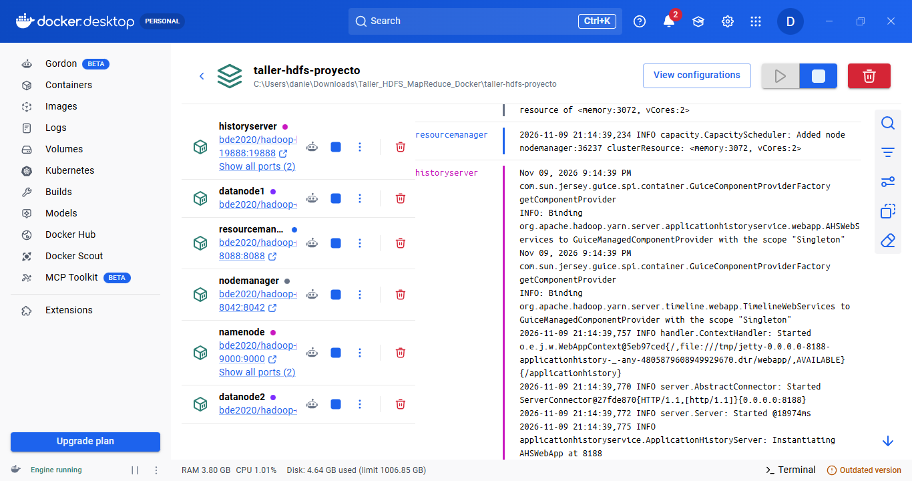

### 3.3. Verificación de los DataNodes

Para comprobar la comunicación entre el NameNode y los DataNodes se utilizó:

```powershell
docker exec taller-namenode hdfs dfsadmin -report
```

Este comando permite consultar información sobre los nodos conectados, su capacidad y su estado.

En una ejecución correcta de nuestro clúster, el reporte muestra:

```text
Live datanodes (2):
```

También se utilizó la interfaz web del NameNode:

`http://localhost:9870`

Desde la sección **Datanodes** se puede visualizar la información de los nodos conectados al clúster.

**Evidencia 2. Reporte de DataNodes en la terminal**

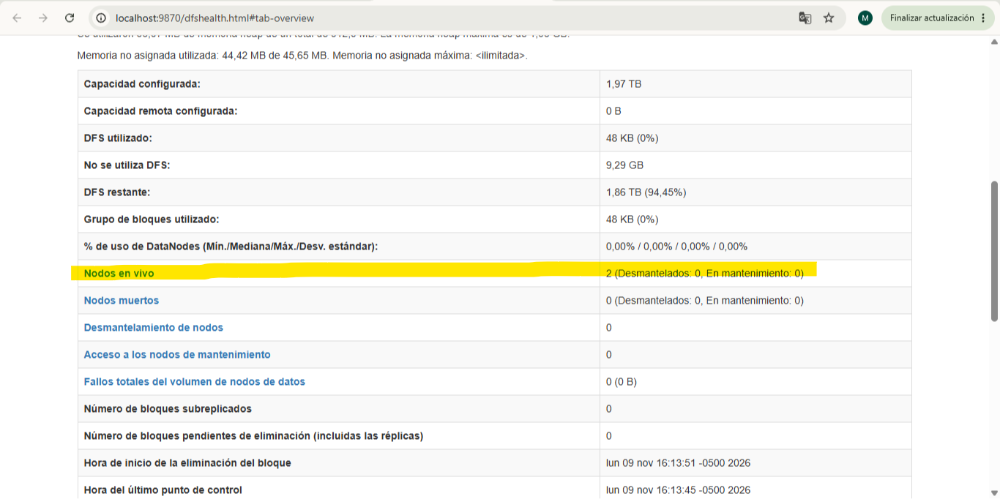

**Evidencia 3. Interfaz web del NameNode**

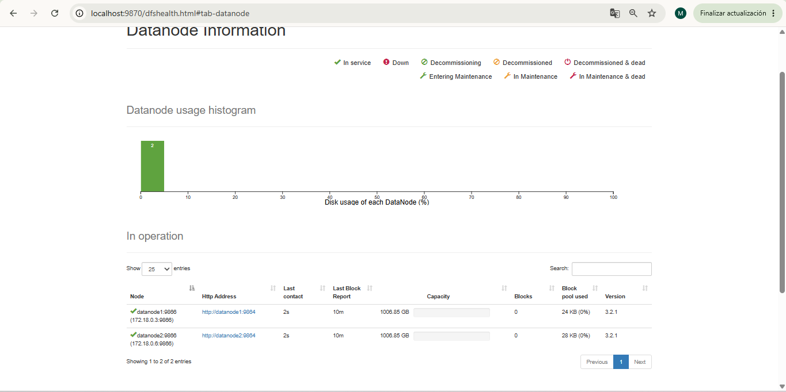

### 3.4. Análisis de la arquitectura

El NameNode es el encargado de administrar la información del sistema de archivos, mientras que los DataNodes almacenan físicamente los bloques.

Esta división es importante porque permite distribuir la información y trabajar con diferentes nodos dentro de un mismo sistema.

Además, la utilización de dos DataNodes permite estudiar cómo HDFS administra las réplicas de información y cómo responde ante la pérdida de uno de sus nodos.

---

## 4. Preparación y carga de archivos en HDFS

Para los ejercicios se utilizaron dos archivos con datos simulados:

- `palabras.txt`: contiene palabras relacionadas con motocicletas y repuestos.
- `ventas.csv`: contiene registros de ventas organizados por fecha, producto, categoría, cantidad y precio unitario.

### 4.1. Creación del directorio

Se creó una carpeta en HDFS para almacenar los archivos:

```powershell
docker exec taller-namenode hdfs dfs -mkdir -p /taller/input
```

### 4.2. Carga de los archivos

Posteriormente, se ejecutaron los comandos:

```powershell
docker exec taller-namenode hdfs dfs -put -f /data/palabras.txt /taller/input/
```

```powershell
docker exec taller-namenode hdfs dfs -put -f /data/ventas.csv /taller/input/
```

Estos comandos permitieron copiar los archivos desde el contenedor hacia el sistema de archivos distribuido HDFS.

### 4.3. Verificación de los datos

Para listar los archivos almacenados:

```powershell
docker exec taller-namenode hdfs dfs -ls /taller/input
```

Para consultar el contenido del archivo CSV:

```powershell
docker exec taller-namenode hdfs dfs -cat /taller/input/ventas.csv
```

Con estos comandos se comprobó que los archivos podían almacenarse y consultarse correctamente desde HDFS.

**Evidencia 4. Archivos cargados en HDFS**

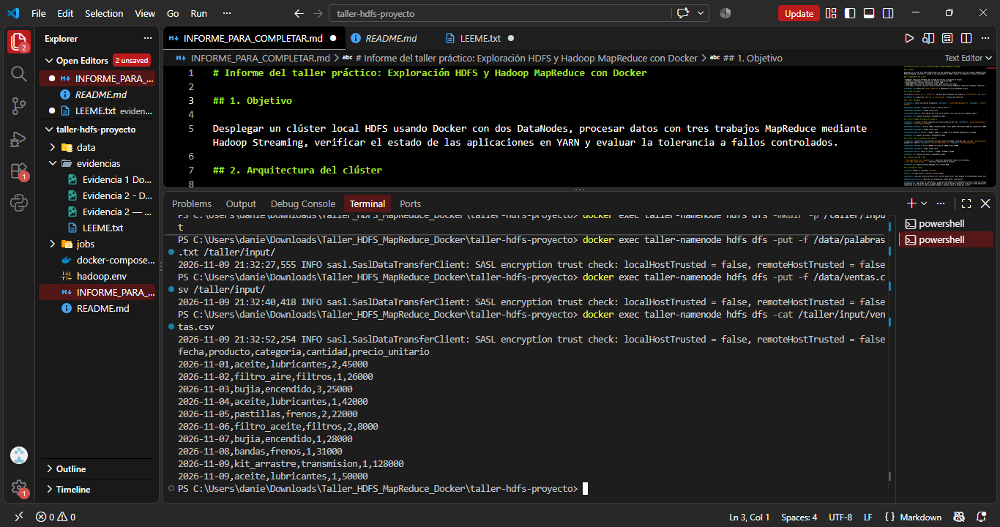

### 4.4. Análisis

Esta actividad permitió comprender la diferencia entre almacenar un archivo directamente en el computador y hacerlo dentro de HDFS.

Aunque los datos inicialmente se encuentran en una carpeta local, después de cargarlos a HDFS pueden utilizarse como entrada de los trabajos MapReduce.

---

## 5. Ejecución de trabajos MapReduce

En esta actividad se ejecutaron tres trabajos utilizando Hadoop Streaming.

MapReduce es un modelo de procesamiento que divide las operaciones en dos etapas principales:

- **Mapper:** recibe los datos de entrada y genera pares de clave y valor.
- **Reducer:** procesa los valores agrupados por clave para producir el resultado final.

### 5.1. Trabajo 1: WordCount

#### Objetivo

Contar cuántas veces aparece cada palabra dentro del archivo `palabras.txt`.

#### Datos utilizados

**Entrada:**

`/taller/input/palabras.txt`

**Salida:**

`/taller/output/palabras`

Los programas utilizados fueron:

- `mapper_palabras.sh`
- `reducer_suma.sh`

#### Verificación de resultados

Para consultar el resultado se ejecutó:

```powershell
docker exec taller-namenode hdfs dfs -cat /taller/output/palabras/part-*
```

Los resultados del conjunto de datos fueron:

| Palabra | Cantidad |
|---|---:|
| aceite | 3 |
| filtro | 2 |
| freno | 2 |
| moto | 3 |

#### Validación manual

Para validar el resultado se revisó el archivo original.

Por ejemplo, la palabra `moto` aparece dos veces en la primera línea y una vez en la segunda.

Por lo tanto:

\[
2+1=3
\]

Esto permite comprobar que el conteo esperado es correcto.

#### Evidencias

**Evidencia 5. Resultado del conteo de palabras**

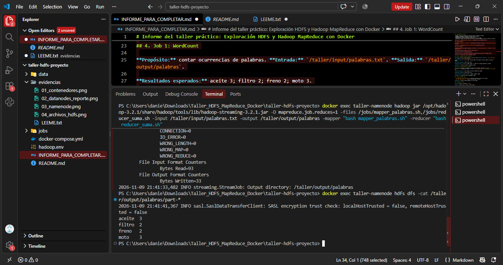

**Evidencia 6. Ejecución de WordCount en YARN**

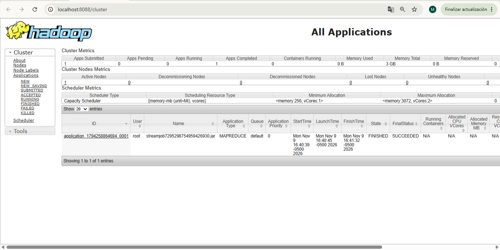

#### Estado del trabajo

**Application ID:** `application_1794258864694_0001`

- Estado: FINISHED
- Resultado final: SUCCEEDED
- Progreso: 100 %

El estado final indica que la aplicación terminó correctamente.

---

### 5.2. Trabajo 2: Promedio de precios por categoría

#### Objetivo

Calcular el precio promedio de los productos agrupados según su categoría.

#### Datos utilizados

**Entrada:**

`/taller/input/ventas.csv`

**Salida:**

`/taller/output/promedio`

Los programas utilizados fueron:

- `mapper_promedio.sh`
- `reducer_promedio.sh`

#### Verificación de resultados

Para consultar el resultado se utilizó:

```powershell
docker exec taller-namenode hdfs dfs -cat /taller/output/promedio/part-*
```

Los resultados esperados para los datos utilizados fueron:

| Categoría | Precio promedio |
|---|---:|
| encendido | $26.500 |
| filtros | $17.000 |
| frenos | $26.500 |
| lubricantes | $45.666,67 |
| transmision | $128.000 |

#### Validación manual

Para comprobar el funcionamiento del cálculo se seleccionó la categoría filtros.

Esta categoría contiene dos precios unitarios:

- Filtro de aire: $26.000
- Filtro de aceite: $8.000

El cálculo fue:

\[
\text{Promedio}=\frac{26000+8000}{2}
\]

\[
\text{Promedio}=17000
\]

Por lo tanto, el promedio de precios de la categoría filtros es de **$17.000**.

En este caso se calculó un promedio simple de los precios unitarios de cada registro, sin ponderarlos por las cantidades vendidas.

#### Evidencias

**Evidencia 7. Resultado del promedio por categoría**

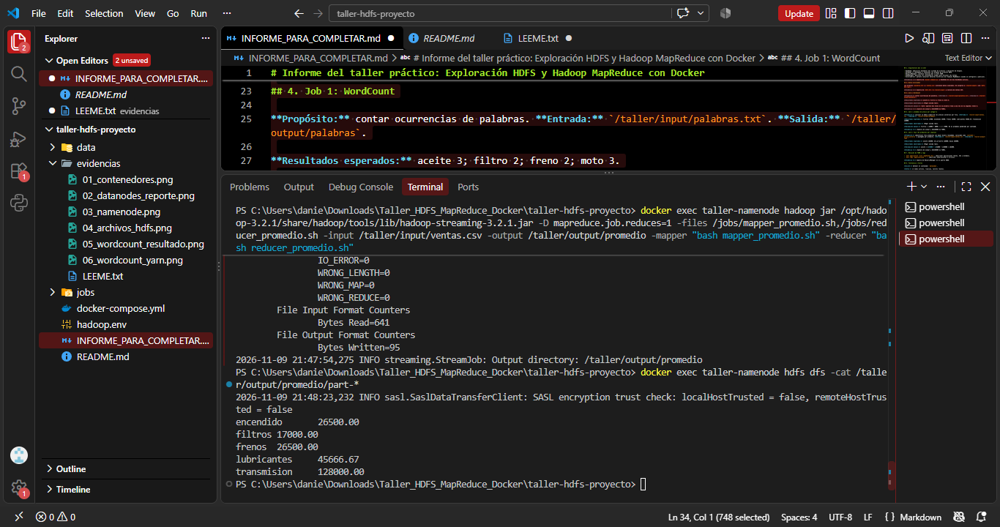

**Evidencia 8. Ejecución del promedio en YARN**

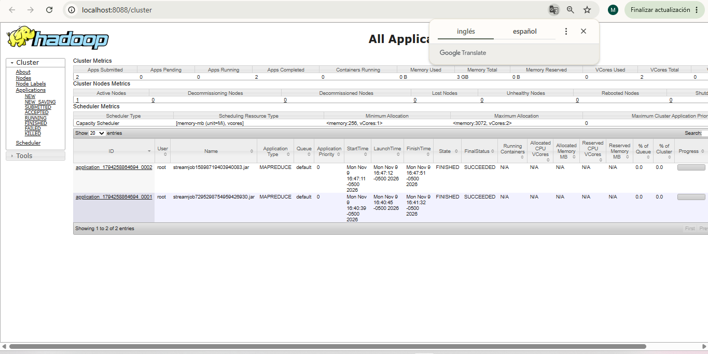

#### Estado del trabajo

**Application ID:** `application_1794258864694_0002`

- Estado: FINISHED
- Resultado final: SUCCEEDED
- Progreso: 100 %

El resultado demuestra que el trabajo se ejecutó correctamente en YARN.

---

### 5.3. Trabajo 3: Top 3 de productos con mayores ingresos

#### Objetivo

Identificar los tres productos que generan mayores ingresos dentro de los datos simulados.

Para este ejercicio, los ingresos se calcularon multiplicando la cantidad vendida por el precio unitario.

#### Datos utilizados

**Entrada:**

`/taller/input/ventas.csv`

**Salida:**

`/taller/output/top3`

Los programas utilizados fueron:

- `mapper_top3.sh`
- `reducer_top3.sh`

#### Verificación de resultados

Para consultar el resultado se ejecutó:

```powershell
docker exec taller-namenode hdfs dfs -cat /taller/output/top3/part-*
```

Los resultados esperados fueron:

| Posición | Producto | Ingresos |
|---|---|---:|
| 1 | aceite | $182.000 |
| 2 | kit_arrastre | $128.000 |
| 3 | bujia | $103.000 |

#### Validación manual

Para validar los ingresos del aceite se tomaron los tres registros correspondientes.

Los registros fueron:

- 2 unidades a $45.000 = $90.000
- 1 unidad a $42.000 = $42.000
- 1 unidad a $50.000 = $50.000

El cálculo fue:

\[
90000+42000+50000=182000
\]

Por lo tanto, el producto aceite generó ingresos por **$182.000** dentro de los datos de prueba.

Este ejercicio demuestra cómo MapReduce puede utilizarse para analizar información de ventas y obtener resultados útiles para la toma de decisiones.

#### Evidencias

**Evidencia 9. Resultado del Top 3 de productos**

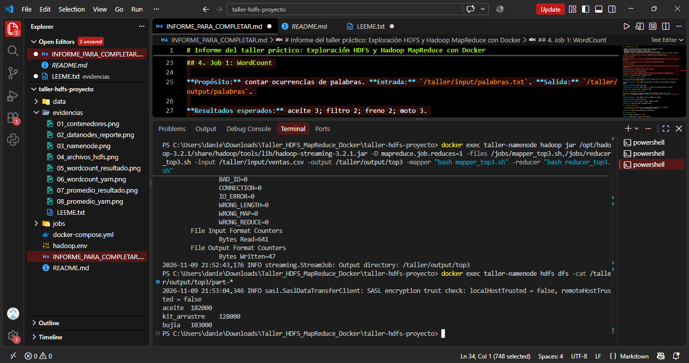

**Evidencia 10. Ejecución del Top 3 en YARN**

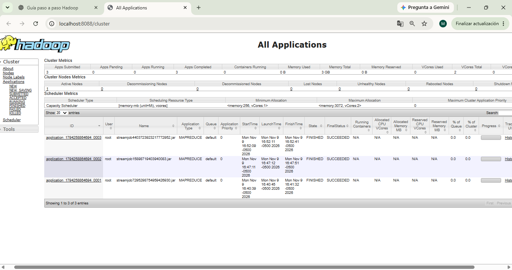

#### Estado del trabajo

**Application ID:** `application_1794258864694_0003`

- Estado: FINISHED
- Resultado final: SUCCEEDED
- Progreso: 100 %

---

## 6. Verificación de aplicaciones en YARN y revisión de logs

Después de ejecutar los tres trabajos MapReduce se utilizó YARN para comprobar sus estados de ejecución.

### 6.1. Consulta de aplicaciones

El comando utilizado fue:

```powershell
docker exec taller-namenode yarn application -list -appStates ALL
```

La consulta mostró tres aplicaciones MapReduce.

| Aplicación | Estado | Estado final | Progreso |
|---|---|---|---:|
| application_1794258864694_0001 | FINISHED | SUCCEEDED | 100 % |
| application_1794258864694_0002 | FINISHED | SUCCEEDED | 100 % |
| application_1794258864694_0003 | FINISHED | SUCCEEDED | 100 % |

Los tres trabajos terminaron satisfactoriamente.

Esto permitió confirmar que YARN ejecutó las aplicaciones y registró correctamente su finalización.

**Evidencia 11. Tres aplicaciones verificadas en YARN**

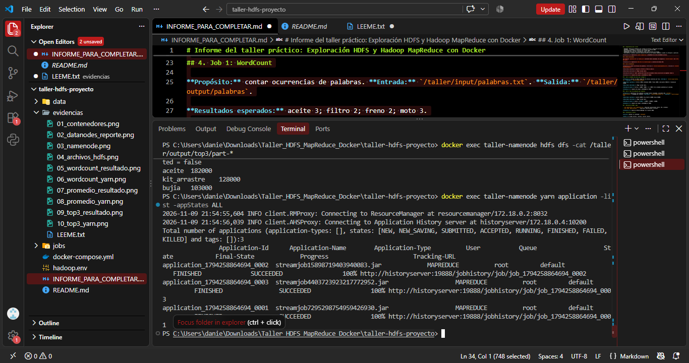

### 6.2. Revisión de logs

También se consultaron los registros de ejecución mediante los identificadores reales de las aplicaciones.

Los comandos utilizados fueron:

**WordCount:**

```powershell
docker exec taller-namenode yarn logs -applicationId application_1794258864694_0001 2>&1 | Select-Object -Last 40
```

**Promedio por categoría:**

```powershell
docker exec taller-namenode yarn logs -applicationId application_1794258864694_0002 2>&1 | Select-Object -Last 40
```

**Top 3 de productos:**

```powershell
docker exec taller-namenode yarn logs -applicationId application_1794258864694_0003 2>&1 | Select-Object -Last 40
```

Los logs permiten conocer detalles relacionados con la ejecución de las aplicaciones, revisar mensajes generados por los procesos e identificar posibles errores.

Esta herramienta resulta importante para el monitoreo de sistemas distribuidos porque permite analizar lo que ocurrió durante la ejecución de un trabajo.

#### Evidencias

**Evidencia 12. Logs del trabajo WordCount**

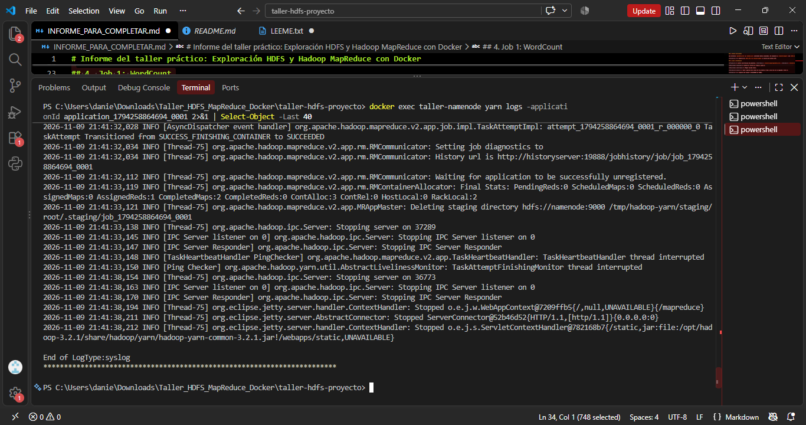

**Evidencia 13. Logs del trabajo de promedio**


**Evidencia 14. Logs del trabajo Top 3**

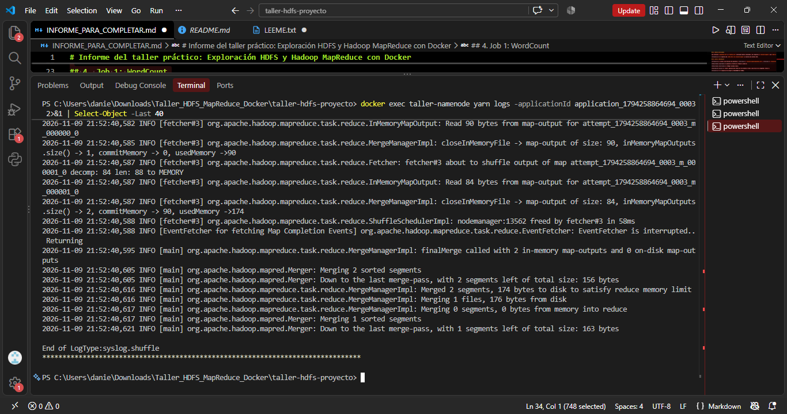

---

## 7. Evaluación de tolerancia a fallos en HDFS

La última actividad consistió en evaluar el comportamiento de HDFS cuando uno de sus nodos de almacenamiento deja de funcionar.

Para realizar esta prueba se utilizó un factor de replicación configurado en 2.

Esto significa que HDFS intenta mantener dos copias de cada bloque en DataNodes diferentes.

### 7.1. Estado inicial del clúster

Antes de provocar el fallo se consultó el estado del clúster utilizando:

```powershell
docker exec taller-namenode hdfs dfsadmin -report
```

También se verificó el estado de los bloques del archivo `ventas.csv`:

```powershell
docker exec taller-namenode hdfs fsck /taller/input/ventas.csv -files -blocks -locations
```

Estas verificaciones permitieron obtener información sobre los nodos activos y las réplicas de los bloques antes de realizar la prueba.

**Evidencia 15. Estado inicial de HDFS**

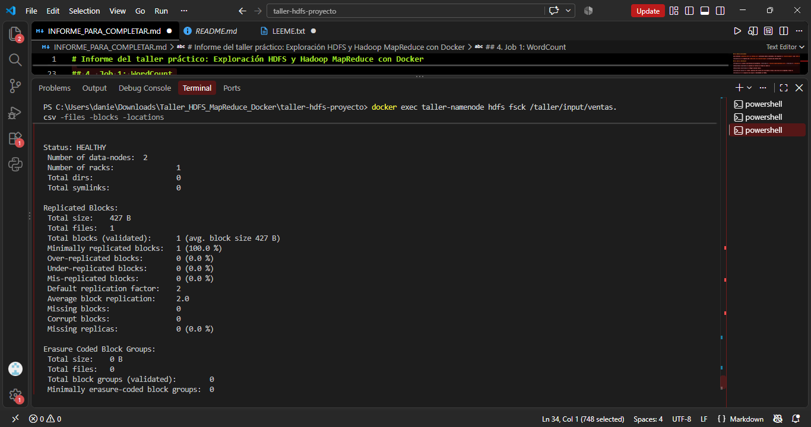

### 7.2. Detención de un DataNode

Para simular un fallo controlado se detuvo el segundo DataNode mediante:

```powershell
docker compose stop datanode2
```

Después se consultó el estado de los contenedores:

```powershell
docker compose ps -a
```

Esta prueba permitió simular la pérdida de uno de los nodos de almacenamiento sin eliminar los datos ni detener el NameNode.

**Evidencia 16. DataNode detenido**

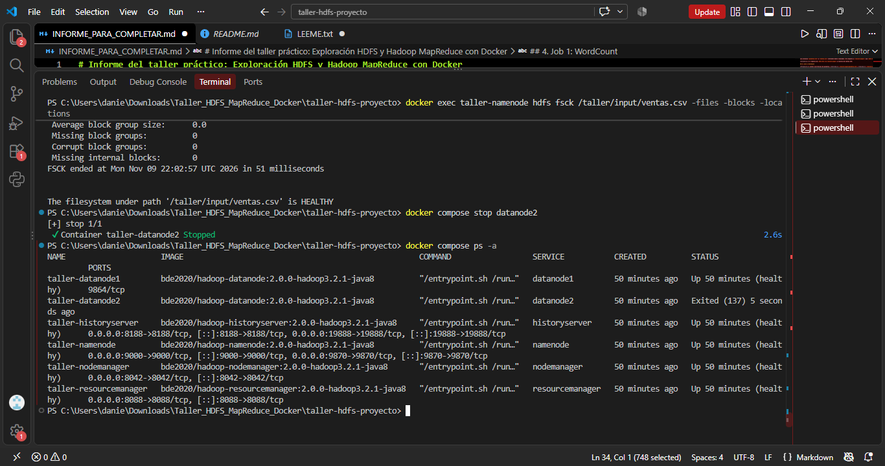

### 7.3. Verificación de lectura durante el fallo

Con el segundo DataNode detenido, se utilizó el siguiente comando:

```powershell
docker exec taller-namenode hdfs dfs -cat /taller/input/ventas.csv
```

La finalidad fue comprobar si HDFS podía continuar accediendo al archivo utilizando la réplica disponible en el otro DataNode.

**Resultado observado:** [Escribir si el archivo se pudo leer completamente o si apareció algún error].

Si HDFS conserva una réplica funcional de todos los bloques necesarios, puede continuar proporcionando acceso al archivo aunque uno de los nodos esté detenido.

**Evidencia 17. Lectura durante el fallo**

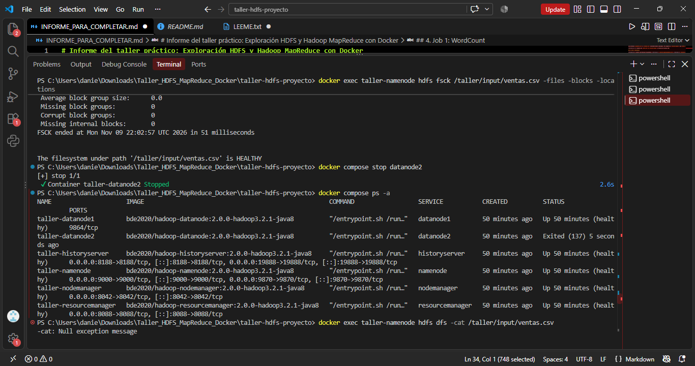

### 7.4. Estado de HDFS durante el fallo

Para analizar el comportamiento del sistema se ejecutaron nuevamente:

```powershell
docker exec taller-namenode hdfs dfsadmin -report
```

```powershell
docker exec taller-namenode hdfs fsck /taller/input/ventas.csv -files -blocks -locations
```

**Resultado observado:** [Escribir cuántos DataNodes vivos aparecieron y si se reportaron bloques con menos réplicas].

La pérdida de un DataNode puede afectar temporalmente el número de réplicas disponibles.

Sin embargo, cuando existe otra réplica funcional, HDFS puede mantener el acceso a la información.

También es importante tener en cuenta que el NameNode utiliza mensajes periódicos llamados *heartbeats* para supervisar a los DataNodes, por lo que la detección de un nodo caído no siempre ocurre de manera inmediata.

**Evidencia 18. Estado del clúster durante el fallo**


### 7.5. Recuperación del DataNode

Después de realizar la prueba se inició nuevamente el segundo DataNode mediante:

```powershell
docker compose start datanode2
```

Se comprobó el estado de los contenedores:

```powershell
docker compose ps
```

Posteriormente se consultó nuevamente el estado de HDFS:

```powershell
docker exec taller-namenode hdfs dfsadmin -report
```

También se revisó el archivo con:

```powershell
docker exec taller-namenode hdfs fsck /taller/input/ventas.csv -files -blocks -locations
```

**Resultado observado:** [Escribir si volvieron a aparecer dos DataNodes vivos y si el archivo quedó en estado HEALTHY].

Esta actividad permite analizar cómo se recupera el funcionamiento de HDFS después de reiniciar un nodo que había dejado de estar disponible.

**Evidencia 19. Recuperación del DataNode**

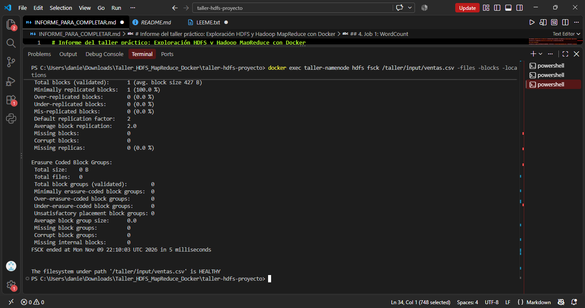

### 7.6. Análisis de la tolerancia a fallos

La prueba de tolerancia a fallos permitió estudiar uno de los mecanismos más importantes de HDFS: la replicación de bloques.

Este mecanismo permite reducir la dependencia de un solo nodo, ya que los bloques pueden mantenerse en diferentes DataNodes.

Cuando un nodo deja de funcionar, HDFS puede utilizar una réplica disponible para continuar proporcionando acceso a los datos.

Sin embargo, la disponibilidad de un archivo y el mantenimiento del número de réplicas son aspectos diferentes.

Durante una interrupción, el sistema puede conservar el acceso al archivo y al mismo tiempo presentar una reducción temporal en la redundancia de los bloques.

Por esta razón, es necesario revisar los reportes de HDFS y comprobar que los nodos y las réplicas se recuperen correctamente.

---

## 8. Análisis general de los resultados

Durante el desarrollo del taller se trabajó con dos funciones principales del ecosistema Hadoop: el almacenamiento distribuido y el procesamiento de datos.

En la primera parte se configuró un clúster mediante Docker Compose, lo que permitió trabajar con un NameNode y dos DataNodes.

Posteriormente se cargaron archivos en HDFS y se comprobó que podían consultarse mediante comandos.

En la segunda parte se ejecutaron tres trabajos MapReduce:

1. WordCount para contar palabras.
2. Promedio para calcular precios por categoría.
3. Top 3 para identificar productos con mayores ingresos.

Los tres trabajos quedaron registrados en YARN con estados `FINISHED` y `SUCCEEDED`, además de un progreso del 100 %.

También se realizaron validaciones manuales para comprobar los cálculos realizados sobre los datos de prueba.

Por último, se exploró la tolerancia a fallos mediante la interrupción controlada de uno de los nodos de almacenamiento.

Estas actividades permitieron comprender la relación entre el almacenamiento, el procesamiento, el monitoreo y la disponibilidad de la información en Hadoop.

---

## 9. Conclusiones

El desarrollo de este taller me permitió comprender de manera más práctica cómo funciona Hadoop y cuáles son las responsabilidades de sus principales componentes.

Uno de los aprendizajes más importantes fue entender la diferencia entre el NameNode y los DataNodes. El NameNode administra la información relacionada con los archivos, mientras que los DataNodes se encargan de almacenar sus bloques.

También comprendí la importancia de YARN, ya que permite administrar los recursos y supervisar la ejecución de los trabajos.

Por otra parte, los tres ejercicios MapReduce demostraron que este modelo de programación puede utilizarse para resolver diferentes necesidades de procesamiento, como contar palabras, calcular promedios y analizar ingresos por producto.

Otro aspecto importante fue aprender que no basta con ejecutar los comandos. También es necesario verificar los resultados, consultar los estados de las aplicaciones y revisar los registros para comprobar que los procesos se ejecutaron correctamente.

Finalmente, la prueba de tolerancia a fallos permitió estudiar la importancia de la replicación de bloques y los mecanismos que utiliza HDFS para supervisar el estado de sus nodos.

En general, considero que esta actividad fue útil porque permitió llevar a la práctica conceptos de Big Data que normalmente se estudian de manera teórica. Aunque el ejercicio se realizó en un entorno local y con archivos pequeños, ayudó a comprender los principios básicos de los sistemas distribuidos.

---

## 10. Referencias bibliográficas

- Apache Software Foundation. [Documentación oficial de Apache Hadoop](https://hadoop.apache.org/docs/).
- Apache Software Foundation. [HDFS Architecture](https://hadoop.apache.org/docs/r3.2.1/hadoop-project-dist/hadoop-hdfs/HdfsDesign.html).
- Apache Software Foundation. [MapReduce Tutorial](https://hadoop.apache.org/docs/r3.2.1/hadoop-mapreduce-client/hadoop-mapreduce-client-core/MapReduceTutorial.html).
- Docker. [Docker Compose Documentation](https://docs.docker.com/compose/).
- Martínez, Heberth. *Taller práctico: Exploración de HDFS y Hadoop MapReduce con Docker*. Material de clase.
